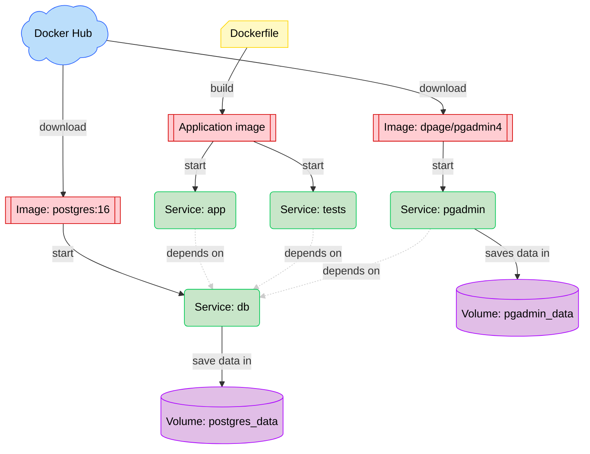

Dette projekt er et setup til data engineering projekter, hvor der bruges Python, pytest og PostgreSQL.

Projektet er sat op med Docker, Docker Compose og Dev Container.

Der er også sat en pgAdmin container op, hvor forbindelsen til postgres databasen er præ-konfigureret.

# Setup Guide
## Installer WSL og Docker Desktop

### Windows Subsystem for Linux (WSL)

Docker skal bruge WSL for at kunne køre. For at installere det:
1. Åben PowerShell som Administrator.
2. Brug kommandoen ``wsl --install``
3. Genstart din computer
4. Åben igen PowerShell
5. Verificer installationen med kommandoen ``wsl --version``

### Docker Desktop

1. Download Docker Desktop til windows fra https://www.docker.com/products/docker-desktop/
2. Installer Docker Desktop
3. Åben docker desktop
4. Åben PowerShell og brug kommandoen ``docker --version`` for at verificere at installationen er korrekt
5. Brug kommandoen ``docker run hello-world``. Du har nu startet din første Docker container.

---
---

# Container system overview

Systemet består af 4 services:
- ``app`` servicen kører applikationskoden
- ``tests`` servicen kører testene
- ``db`` servicen kører PostgreSQL
- ``pgadmin`` servicen kører pgAdmin

``app`` og ``tests`` servicerne bruger samme application image, som bliver bygget ud fra ``Dockerfile``. ``db`` og ``pgadmin`` bliver startet fra images (``postgres:16`` og ``dpage/pgadmin4``) hentet fra Docker Hub.

Data fra databasen i ``db`` bliver gemt i ``postgres_data`` volume. ``pgadmin`` gemmer konfigurationsdata i ``pgadmin_data`` volume.

---
## Fil overview
- ``dmi_ohs`` mappen indeholder al applikationskode. Når Docker starter applikationen, starter den ``dmi_ohs/main.py``.
- ``tests`` mappen indeholder alle tests, som bliver kørt af ``tests`` servicen. Der er to undermapper:
  - ``tests/unit`` mappen indeholder alle unit tests, som er test af kode indenfor jeres applikation.
  - ``tests/integration`` mappen indeholder integrationstests mod PostgreSQL, herunder indlæsning, gentagne indlæsninger og rollback ved fejl.
- ``.gitignore`` filen er en text fil, der beskriver hvilke filer og fil typer, der ikke skal skubbes til git.
- ``dockerignore`` filen er en text fil, der beskriver hvilke filer, der ikke skal kopieres ind i docker images
- ``requirements.txt`` er text fil, der lister alle de libraries, der skal bruges til at køre applikationen.
- ``requirements-dev.txt`` er en text fil, der lister alle de libraries, der skal bruges til at køre testene, men ikke bruges til at køre applikationen.
- ``.devcontainer`` mappen indeholder config filer til Dev Container
- ``pgadmin`` mappen indeholder config filer til pgAdmin

---
---
# Startup guide

## Lav .env fil
- I projektets root, skal du lave en ny fil, der hedder ``.env``, den indeholder miljø variabler for projektet. ``.env`` filen indeholder hemmeligheder som koder eller tokens, som ikke skal deles offentligt af sikkerhedshensyn. ``.env`` er derfor inkluderet i ``.gitignore``, så de ikke bliver synced med git.
- De følgende miljøvariable (environment variables) skal sættes i ``.env``. ``POSTGRES_HOST=db``, ``POSTGRES_PORT=5432`` og ``POSTGRES_USER=admin`` skal ikke ændres, men resten af værdierne er vilkårlige. ``POSTGRES_USER`` er som standard ``admin``, fordi pgAdmin-forbindelsen i ``pgadmin/servers.json`` bruger det brugernavn; ændres det, skal ``servers.json`` også ændres.

```
POSTGRES_DB=postgres_db

POSTGRES_USER=admin

POSTGRES_PASSWORD=password

POSTGRES_HOST=db

POSTGRES_PORT=5432

TEST_POSTGRES_DB=dmi_ohs_test

PGADMIN_USER_EMAIL=admin@example.com

PGADMIN_PASSWORD=password

DMI_STATION_IDS=06120

DMI_INITIAL_LOOKBACK_HOURS=24
```

``DMI_STATION_IDS`` er en kommasepareret liste over de DMI-stationer, der hentes observationer fra, f.eks. ``06120,06180``. ``DMI_INITIAL_LOOKBACK_HOURS`` angiver, hvor mange timer bagud der hentes for en station, som endnu ikke har observationer i databasen, f.eks. første gang eller når en ny station tilføjes til listen. Begge er valgfrie; standardværdierne er vist ovenfor, og ``.env`` bør have de samme linjer som ``.env.example``.

---
## Dev container

En af udfordringerne med Docker, er at ens IDE ikke har adgang til ens dependencies og pakker. Det betyder, den kan vise fejl i ens kode pga. manglende installationer, selvom dette ikke vil være et problem ved runtime, da de der vil være installeret i ens container. Man kan heller ikke bruge intellisense fra ens pakker i IDE'en.

Løsningen er en Dev Container, som er en Docker container, hvor ens dependencies are installeret som man kan åbne VS Code i. For at åbne projektet i en dev container:
1. Installer ``Dev Containers`` extension i VS Code
2. Tryk ``ctrl`` + ``shift`` + ``p`` for at få command pallete frem
3. Brug kommandoen ``Dev Containers: Reopen in Container``
	- Dette skridt kan godt tage et stykke tid første gang
4. Nede i venstre hjørne af VS Code vil der nu være et blåt mærke, hvor der står ``Dev Container: ...`` op du har nu adgang til dine dependencies.
5. For at lukke dev containeren, åben command pallete (``ctrl`` + ``shift`` + ``p``) og brug kommandoen ``Dev Containers: Reopen Folder Locally``

### Dev container og Docker Compose er adskilte

Dev containeren bruges kun til at skrive kode (IntelliSense og fejlmarkering). Den er ikke en del af Docker Compose-projektet og kan ikke nå ``db``. Kør derfor alle ``docker compose``-kommandoer i en WSL-terminal i projektets root, **uden for** dev containeren; dev containeren har ikke Docker installeret.

Unit tests uden database kan køres i dev containeren med ``pytest tests/unit``. Kør ikke ``pytest`` uden argumenter der, da integrationstestene kræver databasen. Alle tests køres med ``docker compose run --build --rm tests`` fra WSL.

Dev containeren kører som brugeren ``vscode`` i stedet for root. VS Code giver brugeren samme UID som din WSL-bruger, så filer, der gemmes i dev containeren, ejes af dig i WSL. Hvis filer i projektet alligevel er ejet af root (f.eks. fra en ældre dev container), kan ejerskabet rettes fra WSL med ``sudo chown -R $USER:$USER .`` i projektets root.

#### Hvorfor dev containeren ikke er en Compose-service

Dev containeren har kort været en service i Compose-projektet, så den kunne nå ``db``. Det virker ikke med Docker Compose 5.6.1 og Buildx 0.37.2 eller nyere: "Rebuild Container" fejler med ``additional privileges requested: pass "--allow=fs.read=/tmp/devcontainercli-.../Dockerfile-with-features"``. Dev Containers-extensionen lægger en genereret Dockerfile i ``/tmp``, uden for build-konteksten, og Compose giver ikke Buildx lov til at læse den. Det er en fejl i Docker Compose ([docker/compose#14285](https://github.com/docker/compose/issues/14285)), som er rettet i [docker/compose#14325](https://github.com/docker/compose/pull/14325), men endnu ikke udgivet. Når en Compose-version nyere end 5.6.1 med rettelsen er udgivet, kan opsætningen overvejes igen.

---
## Start og stop applikationen

1. Sørg for at Docker Desktop er åben i baggrunden
2. Åben terminalen i projektets root mappe
3. Brug kommandoen ``docker compose up --build app``
	- ``postgres:16`` image bliver hentet fra Docker Hub *(ved første kørsel)*, og ``db`` servicen bliver startet
	- Application imaget bliver bygget ud fra ``Dockerfile``, og ``app`` servicen bliver startet
        - *(Imaget bliver kun genbygget, hvis der er sket ændringer, der nødvendiggør det på grund af caching.)*
4. Brug kommandoen ``docker compose down``
	- ``db`` og ``app`` servicerne bliver stoppet.

App-servicen henter som standard observationer direkte fra DMI's
observations-API (``opendataapi.dmi.dk``, kræver ingen API-nøgle). Hver kørsel
fortsætter for hver station fra dens nyeste gemte observation, minus én times
overlap, så sent ankomne rækker også kommer med. Er databasen tom, hentes de
seneste ``DMI_INITIAL_LOOKBACK_HOURS`` timer. Overlappet giver ikke dubletter,
fordi alle rækker indsættes med upsert.

Pipeline'en validerer og transformerer data og indsætter eller opdaterer
katalogdata, stationer og observationer i PostgreSQL i én transaktion. Ved
succes udskrives antal inputrækker sendt til upsert for hver tabel; tallene er
ikke antal nye eller ændrede rækker. Hvis API'et ikke har nye observationer,
udskrives en besked, og intet indlæses.

Følgende situationer stopper ikke indlæsningen, men giver en advarsel:
- Observationer med et parameter-id, der ikke findes i det lokale katalog, springes over.
- Hvis en station har fået nye koordinater, overskrives de gamle.
- Hvis samme måling (station, parameter og tidspunkt) er gemt under flere observations-id'er, beholdes alle rækker.

En gemt JSON-fil kan indlæses i stedet for API'et med ``--file``, hvis filen er
tilgængelig i containeren, for eksempel en fil i den monterede
``sample_data``-mappe:

``docker compose run --build --rm app python -m dmi_ohs.main --file /dmi-ohs-data-pipeline/sample_data/odense-observations-2026-10-07.json``

---
## Køre testene

1. Sørg for at Docker Desktop er åben i baggrunden.
2. Åben terminalen i projektets root,
3. Brug kommandoen ``docker compose run --build --rm tests``
  - ``postgres:16`` image bliver hentet fra Docker Hub *(ved første kørsel)*, og ``db`` servicen bliver startet.
	- Application imaget bliver bygget ud fra ``Dockerfile``, og ``tests`` servicen bliver startet
	- ``tests`` servicen lukker automatisk efter kørsel på grund af ``--rm`` flaget.
4. Brug kommandoen ``docker compose down``
  - ``db`` servicen bliver nu stoppet.
    - *(Den bliver automatisk startet, når ``tests`` servicen bliver startet, men den bliver ikke automatisk stoppet, da andre services, f.eks. ``app``, kan være afhængige af den.)*

Tests-servicen bruger en separat database på samme PostgreSQL-server.
``TEST_POSTGRES_DB`` vælger testdatabasens navn og er som standard
``dmi_ohs_test``. Når PostgreSQL-volume'en initialiseres første gang, opretter
``database/init-test-db.sh`` denne database og anvender samme
``database/schema.sql`` som app-databasen. Testenes ``TRUNCATE``-kommandoer
rammer dermed kun testdatabasen.

Testene omfatter unit tests af parsing, validering, katalog og API-klienten
(med en falsk HTTP-session, så der ikke kaldes ud på nettet) samt
PostgreSQL-integrationstests af indlæsning, idempotens, rollback, advarsler og
det inkrementelle hentevindue. Integrationstestene kræver databaseforbindelsen
fra Compose-miljøet.

---
## pgAdmin

pgAdmin er et værktøj til at administrere PostgreSQL-databaser. Det kan være praktisk til at visualisere ens database og konstruere queries.

Der er en pgAdmin container sat up i projektet. For at åbne den:
1. Åben terminallen i projektets root
2. Brug kommandoen ``docker compose up -d pgadmin``
3. Åben din browser og gå ind på http://localhost:8080/. Det kan godt tage lidt tid at få forbindelse
4. Login med pgAdmin credentials fra ``.env`` filen
5. Forbindelsen til databasen er allerede konfigureret. Når du connecter med databasen vil du blive promptet til at indtaste et password. Det er postgres passwordet fra ``.env`` filen

pgAdmin (port 8080) er kun tilgængelig fra din egen maskine (``127.0.0.1``), ikke fra andre maskiner på netværket. PostgreSQL har ingen port udadtil: ``app``, ``tests`` og ``pgadmin`` når databasen som ``db:5432`` på Docker Compose-netværket, og ``psql`` kan køres med ``docker compose exec db psql -U admin -d postgres_db``.

---
## Databaseskema

Databaseskemaet ligger i ``database/schema.sql``. Docker monterer filen i
PostgreSQLs ``/docker-entrypoint-initdb.d``-mappe, så PostgreSQL kører den
automatisk på app-databasen, første gang PostgreSQL-volume'en initialiseres.
Derefter opretter ``database/init-test-db.sh`` testdatabasen fra
``TEST_POSTGRES_DB`` (standard: ``dmi_ohs_test``) og anvender det samme skema.

Init-filerne bliver kun kørt automatisk, når PostgreSQL-volume'en oprettes
første gang. For at aktivere den nye testdatabase på en allerede eksisterende
volume skal den genskabes:

``docker compose down -v``

**Advarsel:** Kommandoen sletter ``postgres_data`` med app- og testdatabasen
samt ``pgadmin_data`` med pgAdmin-indstillinger. Brug den kun, mens disse data
må gå tabt. Derefter starter ``docker compose run --build --rm tests`` begge
databaser automatisk.

Skemaet består af:

- ``stations``: station-id og koordinater udtrukket fra observationerne.
- ``parameters``: statiske descriptions, units og frekvenser fra
  ``reference_data/dmi-parameter-catalog.json``.
- ``parameter_value_codes``: forklaringer på parameter-specifikke numeriske
  værdier, for eksempel vejrkoder.
- ``observations``: aktuelle observationer fra DMI's observations-API.

Pipeline'en henter observationer for hver station i ``DMI_STATION_IDS``, én
station ad gangen og i hver sin transaktion. Hvis én station fejler, bliver de
øvrige stadig indlæst, og kørslen afsluttes med en fejl, der nævner den
fejlede station. Pipeline'en kalder ikke station-API'et. Når der senere kommer
måleudstyr inde i bygningen, kan observationerne udvides med en kilde- eller
enhedsidentifikator.

``database/schema.sql`` bruges som bootstrap for en ny database. Et
eksisterende persistent ``postgres_data``-volume opdateres ikke automatisk,
når filen ændres. Når databasen senere indeholder data, bør projektet skifte
til migrations i stedet for at slette volume'en.

---
---
# Libraries

Fordi projektet køres og udvikles i Docker containere, skal der ikke installeres nogen libraries lokalt. Istedet, skal de listes i ``requirements.txt`` filen, så bliver de automatisk inkluderet i ens Docker image. Når man har lagt et nyt library ind i ``requirements.txt`` er det en god ide at genbygge og genstarte ens dev container med command pallete kommandoerne:
- ``Dev Containers: Reopen Folder Locally``
- ``Dev Containers: Rebuild and Reopen in Container``

Det er forresten best practice at lave **version pinning** i sin ``requirements.txt`` fil. Det betyder at man istedet for at referere en pakke f.eks. ``pandas``, så refererer man en specifik version af pandas f.eks. ``pandas==3.0.5``. Det sikrer, at det samme version bliver brugt i hver build for consistency.

---
---
# Docker / Docker Compose kommandoer

Køres i en WSL-terminal i projektets root, uden for dev containeren.

- **Start ``app``:** ``docker compose up --build app``
- **Kør ``tests``:** ``docker compose run --build --rm tests``
- **Stop services:** ``docker compose down``
- **Stop services og slet volumes:** ``docker compose down -v``
- **Start ``pgadmin``:** ``docker compose up -d pgadmin``
- **Se alle containers:** ``docker compose ps -a``
- **Se alle images:** ``docker image ls``
- **Slet alle images:** ``docker image prune -a``
- **Se alle volumes:** ``docker volume ls -a``