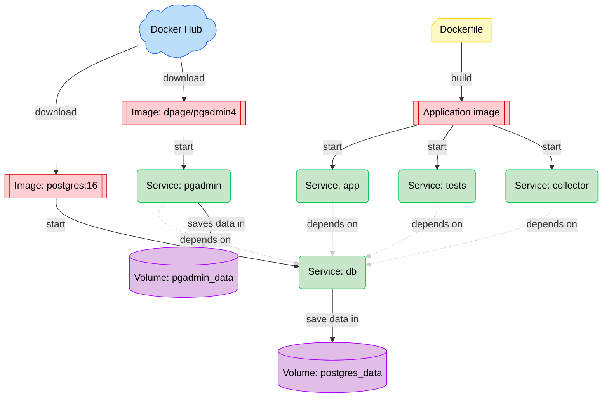

# DMI OHS Data Pipeline

A data engineering pipeline that fetches weather observations from the DMI (Danish Meteorological Institute) observation API, validates and transforms them, and loads them into PostgreSQL. It is written in Python, tested with pytest, and runs entirely in Docker, using Docker Compose and a VS Code Dev Container. A pgAdmin container with a preconfigured connection to the database is included.

**Contents**

- [Setup](#setup)
- [Architecture](#architecture)
- [Running the project](#running-the-project)
- [How the pipeline works](#how-the-pipeline-works)
- [Database](#database)
- [Checking the data](#checking-the-data)
- [Dev container](#dev-container)
- [Libraries and Python version](#libraries-and-python-version)
- [Command reference](#command-reference)
- [Status and next steps](#status-and-next-steps)

---

# Setup

## Install WSL and Docker Desktop

### Windows Subsystem for Linux (WSL)

Docker needs WSL to run. To install it:

1. Open PowerShell as Administrator.
2. Run `wsl --install`.
3. Restart your computer.
4. Open PowerShell again.
5. Check the installation with `wsl --version`.

Keep the repository in the WSL filesystem (e.g. `/home/<user>/dmi-ohs-data-pipeline`), not under `/mnt/c`, for file performance.

### Docker Desktop

1. Download Docker Desktop for Windows from https://www.docker.com/products/docker-desktop/.
2. Install Docker Desktop.
3. Open Docker Desktop.
4. Open PowerShell and run `docker --version` to check the installation.
5. Run `docker run hello-world`. You have now started your first Docker container.

## Create the .env file

Settings come from environment variables, which Compose reads from a `.env` file in the project root. `.env` holds secrets such as passwords, so it is listed in `.gitignore` and never committed. `.env.example` is its template. Create your own copy from WSL in the project root:

```bash
cp .env.example .env
```

```
POSTGRES_DB=postgres_db
POSTGRES_USER=admin
POSTGRES_PASSWORD=password
POSTGRES_HOST=db
POSTGRES_PORT=5432
TEST_POSTGRES_DB=dmi_ohs_test
PGADMIN_USER_EMAIL=admin@example.com
PGADMIN_PASSWORD=password
DMI_STATION_IDS=06120
DMI_INITIAL_LOOKBACK_HOURS=24
DMI_RUN_INTERVAL_MINUTES=10
```

Keep `POSTGRES_HOST=db`, `POSTGRES_PORT=5432` and `POSTGRES_USER=admin` as they are. The passwords, email and database names can be anything. `.env` and `.env.example` should contain the same keys, so it is clear which settings are in effect. The code has defaults for the DMI settings, but they should still be written in `.env`.

| Variable | Default | Meaning |
|---|---|---|
| `DMI_STATION_IDS` | `06120` | Comma-separated DMI station IDs to fetch, e.g. `06120,06180`. Kept as text because the leading zero is part of the ID. To add a station, add its ID here and run the pipeline; no code change is needed. |
| `DMI_INITIAL_LOOKBACK_HOURS` | `24` | How far back to fetch for a station with no stored observations (first run, or newly added station). Ignored once the station has data. Set it higher (e.g. `720` for 30 days) before the first run to start with more history. Must be a positive number. |
| `DMI_RUN_INTERVAL_MINUTES` | `10` | Minutes between the start of one `collector` run and the next. Must be a positive number. |
| `POSTGRES_HOST` | — | Address of the PostgreSQL server. `db` is the name of the Compose service. |
| `POSTGRES_PORT` | — | PostgreSQL server port, normally `5432`. |
| `POSTGRES_DB` | — | The app database inside the server. |
| `POSTGRES_USER` | `admin` | Database user. Keep `admin`: `pgadmin/servers.json` connects with that name and cannot read environment variables. |
| `TEST_POSTGRES_DB` | `dmi_ohs_test` | Database used by the tests. Must differ from `POSTGRES_DB`. |
| `PGADMIN_USER_EMAIL`, `PGADMIN_PASSWORD` | — | Login for the pgAdmin web interface. |

`docker-compose.yml` passes these values into each container (`${POSTGRES_DB}` means "use the value from the environment or `.env`"), and `dmi_ohs/database.py` reads them.

---

# Architecture

## Containers



Docker Compose reads `docker-compose.yml` and starts the containers described there. The system has five services:

- `app` runs the pipeline once and exits.
- `collector` runs the pipeline on a schedule, every `DMI_RUN_INTERVAL_MINUTES` minutes.
- `tests` runs pytest.
- `db` runs PostgreSQL, the database server.
- `pgadmin` runs pgAdmin, a web interface for browsing the database and running queries. It does not store the pipeline's data.

`app`, `collector` and `tests` use the same application image, built from `Dockerfile`. `db` and `pgadmin` start from images downloaded from Docker Hub (`postgres:16` and `dpage/pgadmin4`).

PostgreSQL stores the files for all its databases in the `postgres_data` volume, a Docker-managed persistent volume mounted at its data directory. It is storage used by the server, not something to connect to or edit by hand. pgAdmin stores its settings in the `pgadmin_data` volume.

The PostgreSQL port is not published to the host. Everything that uses the database runs as a Compose service and reaches it as `db:5432` on the Compose network. A future dashboard should do the same, connecting to `db:5432` and publishing only its own web port (e.g. `127.0.0.1:3000:3000`). pgAdmin (port 8080) is only reachable from your own machine (`127.0.0.1`), not from other machines on the network.

## Files

- `dmi_ohs/` contains the application code. Docker starts the application with `python -m dmi_ohs.main`.
- `tests/` contains the tests run by the `tests` service:
  - `tests/unit/` tests code within the application, without a database.
  - `tests/integration/` tests against PostgreSQL, including loading, repeated loads and rollback on errors.
- `database/` contains the schema (`schema.sql`) and the script that creates the test database (`init-test-db.sh`).
- `reference_data/` contains the local DMI parameter catalog.
- `sample_data/` contains saved API responses, used by the tests and with `--file`.
- `requirements.txt` lists the libraries needed to run the application.
- `requirements-dev.txt` lists the extra libraries needed to run the tests.
- `.gitignore` lists files that should not be committed to git.
- `.dockerignore` lists files that should not be copied into Docker images.
- `.devcontainer/` contains the Dev Container configuration.
- `pgadmin/` contains the pgAdmin configuration.

---

# Running the project

Run all `docker compose` commands in a WSL terminal in the project root, with Docker Desktop open in the background. Do not run them inside the dev container (see [Dev container](#dev-container)).

## Run the pipeline once

1. Run `docker compose up --build app`.
   - The first time, the `postgres:16` image is downloaded from Docker Hub. The `db` service is started.
   - The application image is built from `Dockerfile`, and the `app` service is started. Thanks to caching, the image is only rebuilt when something has changed that requires it.
2. Run `docker compose down` to stop `db` and `app`.

`docker compose run --build --rm app` does the same and removes the container afterwards. To start the database, pgAdmin and the app together, use `docker compose up --build db pgadmin app`. To start only PostgreSQL in the background, use `docker compose up -d db`.

By default, the app fetches new observations from the DMI API (see [How the pipeline works](#how-the-pipeline-works)). To load a saved JSON file instead, add `--file` with a path that exists in the container, for example a file in the mounted `sample_data` folder:

```bash
docker compose run --build --rm app python -m dmi_ohs.main --file /dmi-ohs-data-pipeline/sample_data/odense-observations-2026-10-07.json
```

## Scheduled collection

The `app` service fetches once and stops. The `collector` service runs the same pipeline repeatedly, every `DMI_RUN_INTERVAL_MINUTES` minutes (default 10, the same frequency as DMI's observations).

1. Start: `docker compose up -d --build collector`
   - `db` is started first if it is not already running. `-d` runs the collector in the background.
2. Follow the log in Docker Desktop under the `collector` container, or with `docker compose logs -f collector`.
   - Each run prints `Run started at …`, one line per station, and `Next run at …`.
3. Stop: `docker compose stop collector`

After changing the code, rebuild and restart the collector with `docker compose up -d --build collector`.

How the collector behaves:

- Runs keep a fixed rhythm. The next run starts one interval after the previous one started, and a run that takes longer than the interval skips the slots it overran instead of running several times back to back.
- The settings are checked once at startup, so a bad `.env` stops the collector immediately with an error.
- A run that fails because of the DMI API or the database is reported as a warning, and the collector tries again at the next run.
- Any other error, such as a bug in the code, stops the process, and Docker does not restart it (`restart: "no"`). The container then shows as *Exited* in Docker Desktop, and `docker compose logs collector` shows the error.
- The collector does **not** start on its own after a PC or Docker Desktop restart. Start it again with `docker compose up -d collector`. No data is lost in the meantime: the first run fetches everything from the newest stored observation onwards.
- `init: true` passes `docker compose stop`'s signal on to Python, so the collector stops straight away instead of after Docker's 10-second timeout. `PYTHONUNBUFFERED=1` in `Dockerfile` makes output appear in the log immediately.
- `--every` and `--file` cannot be combined. `app` and `collector` can run at the same time, because every load is an upsert.

## Run the tests

1. Run `docker compose run --build --rm tests`.
   - The first time, the `postgres:16` image is downloaded. The `db` service is started.
   - The application image is built, and the `tests` service is started. `--rm` removes the container when the tests are done.
2. Run `docker compose down` to stop `db`. It is started automatically with `tests`, but not stopped automatically, because other services such as `app` may depend on it.

The tests cover parsing, input and catalog validation, settings, file errors, the scheduling loop and the API client (using a fake HTTP session, so nothing is fetched from the internet). The PostgreSQL integration tests cover connectivity, loading, repeat loads, rollback, warnings, per-station failures (API and database errors) and the incremental fetch window. The integration tests need the database connection from the Compose environment.

The tests use their own database; see [Test database](#test-database).

## pgAdmin

1. Run `docker compose up -d pgadmin`.
2. Open http://localhost:8080/ in your browser. It can take a moment before it connects.
3. Log in with `PGADMIN_USER_EMAIL` and `PGADMIN_PASSWORD` from `.env`.
4. The connection to the database is already configured. When you connect, enter `POSTGRES_PASSWORD` from `.env`.

To use `psql` instead, run `docker compose exec db psql -U admin -d postgres_db`.

---

# How the pipeline works

## Extraction flow

1. Fetch observations for each station in `DMI_STATION_IDS` from the DMI observation API (`opendataapi.dmi.dk`, no API key needed), or read a saved JSON file given with `--file`.
   - Each station gets its own fetch window. It starts one hour before that station's newest stored observation and ends now. A station with no stored observations gets the last `DMI_INITIAL_LOOKBACK_HOURS`.
   - Each station is loaded in its own transaction. If one station fails, the others are still loaded, and the run then exits with an error naming the failed stations.
   - Pages are requested by offset until a page comes back short.
   - Requests time out and are retried with backoff on rate limits, server errors and dropped connections.
2. Validate and normalize the features into station and observation records.
3. Skip observations whose `parameterId` is missing from `reference_data/dmi-parameter-catalog.json`, with a warning.
4. Upsert parameter metadata, value-code descriptions, stations and observations into PostgreSQL in one transaction.
5. Print warnings, then the number of input rows submitted to each table's upsert. These are not counts of rows newly inserted or changed. If the API has no new observations, a message is printed and nothing is loaded.

Settings errors and an unreadable or invalid `--file` give a clean error message without a traceback.

## Warnings

These situations are reported on stderr but do not stop the load:

- Observations with parameter IDs missing from the catalog are skipped.
- A station with coordinates that differ from those stored (or that differ within one input) is overwritten with the coordinates from its latest observation.
- If the same measurement (station, parameter, observed time) is stored under more than one observation ID, for example because DMI re-issued a corrected value, all rows are kept.

The parameter catalog is local reference data derived from DMI documentation. It supplies the static unit, frequency and coded-value descriptions not included in the observation API.

## Design decisions

- **Incremental fetch window instead of a fixed period.** A missed run, or a pipeline that is down for days, is filled in on the next run, because the window always starts from the newest stored row. The one-hour overlap re-fetches rows that DMI publishes late; the upserts make the overlap harmless.
- **Skip unknown parameters instead of failing.** One new DMI parameter should not block all other data. Add the parameter to the catalog to start loading it.
- **Overwrite moved stations instead of failing.** A station move is unlikely in the near future. If it happens, the warning makes it visible and the newest coordinates are kept. Station history (DMI's `validFrom`/`validTo`) is not modelled.
- **Warn about duplicate measurements, don't prevent them.** It is not yet known whether DMI keeps the same observation ID when it corrects a value. If duplicates show up in practice, add a unique constraint on `(station_id, parameter_id, observed_at)` and change the observation upsert to target it. That is a schema change.
- **One transaction per station.** A station that fails (API error, bad data or a database error) does not roll back or block the others. The run still exits with an error, so a scheduler can notice.
- **Scheduling as a Python loop in a Compose service, not cron or a host scheduler.** The loop is plain Python and unit-tested, needs no extra image, and shows up in Docker Desktop next to the other services. It keeps going when a run fails because of the API or the database; any other error stops it, so a bug shows up as an exited container.
- **The collector is started by hand (`restart: "no"`).** When Docker restarts containers itself, it doesn't go through Compose, so `depends_on` is ignored and `db` stays stopped. That rules out `unless-stopped`, and also `on-failure`: tested on 2026-10-29, a Docker Desktop restart kills the containers with exit code 255, Docker counts that as a failure, and it brought the collector back without `db`. Starting it with `docker compose up -d collector` always starts `db` first. The cost is that a crash from a bug is not restarted, but API and database problems don't crash the loop. Not running costs no data, because the next run fills the gap from the newest stored row.

## DMI API behaviour

Observed on `https://opendataapi.dmi.dk/v2/metObs/collections/observation/items`:

- No API key is required.
- Results are sorted newest first.
- The `datetime=start/end` range includes both ends; a 08:00–09:00 query returns rows observed at 08:00 and at 09:00.
- A `next` link is included even on the last, short page, so paging stops on page size instead (`limit=10000`, normally one page per run).
- Station coordinates are taken from the observation features. The station API (`.../collections/station/items`) is not called; `sample_data/odense-station.json` shows that station 06120 has had several coordinate periods since 1959.
- Observations are published quickly: in the first 24 hours loaded (2026-10-28/29), `created - observed` was about 25 s median and under 40 s for every parameter, so the one-hour overlap has a large margin.
- Station 06120 reports 24 of the 51 catalog parameters, about 86 rows per hour. `weather` and `cloud_height` are only reported some of the time, so the number of rows per hour varies (80–92).

---

# Database

## Schema

The schema is in `database/schema.sql`. The structure is fixed: data is inserted or upserted as rows, and the schema is never changed dynamically.

### `stations`

The station ID and coordinates extracted from the observation API features, one row per station in `DMI_STATION_IDS`. Keeping stations in a separate table prevents coordinates from being repeated on every observation.

Important fields: `station_id` (primary key), `longitude` and `latitude`.

### `parameters`

Static catalog metadata from `reference_data/dmi-parameter-catalog.json`, keyed by `parameter_id`.

Important fields: `parameter_id` (primary key), `description`, `unit` and `frequency`.

### `parameter_value_codes`

Static descriptions for numeric values that have a documented meaning for a specific parameter, such as weather codes or traces of precipitation.

Important fields: `parameter_id`, `code` and `description`, with a composite primary key on `(parameter_id, code)`.

### `observations`

The observations returned by the observation API. Each row keeps its station ID, so observations from several stations share the table. Observation IDs are unique; duplicate measurements under different IDs are only warned about.

Important fields: `observation_id` (primary key, the API feature `id`), `station_id`, `parameter_id`, `observed_at`, `created_at` and `value`.

### Relationships

```text
stations 1 ---- * observations * ---- 1 parameters
parameters 1 ---- * parameter_value_codes
```

A code only has a meaning together with its parameter, so `parameter_value_codes` is keyed by `(parameter_id, code)`. To list the codes for one parameter:

```sql
SELECT code, description
FROM parameter_value_codes
WHERE parameter_id = 'weather'
ORDER BY code;
```

To show observations together with the meaning of their value, join `observations.parameter_id` and `observations.value` to `parameter_value_codes.parameter_id` and `parameter_value_codes.code`. For example, the latest weather observations with their meaning:

```sql
SELECT o.station_id, o.observed_at, o.value, c.description AS value_description
FROM observations o
LEFT JOIN parameter_value_codes c
       ON c.parameter_id = o.parameter_id
      AND c.code = o.value
WHERE o.parameter_id = 'weather'
ORDER BY o.observed_at DESC
LIMIT 5;
```

Example output:

| station_id | observed_at | value | value_description |
|---|---|---|---|
| 06120 | 2026-10-29 20:00:00+00 | 110.0 | Mist |
| 06120 | 2026-10-29 19:50:00+00 | 110.0 | Mist |
| 06120 | 2026-10-29 19:40:00+00 | 110.0 | Mist |
| 06120 | 2026-10-29 19:30:00+00 | 110.0 | Mist |
| 06120 | 2026-10-29 19:20:00+00 | 110.0 | Mist |

`LEFT JOIN` keeps observations whose value has no documented code; their `value_description` is empty. See [Checking the data](#checking-the-data) for how to run a query.

The pipeline currently loads outdoor observations from the DMI stations in `DMI_STATION_IDS`. When indoor measurement hardware is added, the observation model can be extended with a source or device identifier.

## Initialization

Docker mounts `database/schema.sql` into PostgreSQL's `/docker-entrypoint-initdb.d` folder. When the `postgres_data` volume is first initialized, PostgreSQL creates the database named by `POSTGRES_DB` and runs the schema against it. `database/init-test-db.sh` then creates the test database named by `TEST_POSTGRES_DB` and applies the same schema to it. The `db` health check verifies that the test schema exists before Compose starts dependent services.

PostgreSQL only runs these files when its data directory is empty. An existing volume is not updated when `schema.sql` changes. During this early development phase, schema changes are applied by deleting the volume and creating it again:

```bash
docker compose down -v
docker compose run --build --rm tests
```

**Warning:** `docker compose down -v` deletes `postgres_data`, including both databases and their data, and `pgadmin_data`, including pgAdmin settings. Use it only while those data can be discarded. Once the database holds data worth keeping, the project should switch to migrations instead.

## Test database

The `app` and `collector` services connect to `POSTGRES_DB`. The `tests` service connects to a separate database on the same PostgreSQL server, named by `TEST_POSTGRES_DB` (default `dmi_ohs_test`). The integration tests truncate tables in whichever database they connect to, so this separation keeps app data out of reach of the test cleanup. Ordinary test runs never touch the app database.

`tests/conftest.py` always points the tests at `TEST_POSTGRES_DB`, even when `POSTGRES_DB` names the app database (as it does in terminals that load `.env`). Without it, the tests' `TRUNCATE` could wipe the app data.

---

# Checking the data

Run these queries against the app database after a few days of collection and whenever a station is added. Either:

- open pgAdmin (`docker compose up -d pgadmin`, http://localhost:8080), expand *Servers → Postgres → Databases → postgres_db*, right-click it, choose **Query Tool**, paste a query and press **F5**; or
- run `docker compose exec db psql -U admin -d postgres_db` in WSL and paste the query.

**A. Coverage per station.** Expect one row per station, with `latest` close to the time of the last run.

```sql
SELECT station_id, count(*) AS rows, min(observed_at) AS earliest, max(observed_at) AS latest
FROM observations
GROUP BY station_id;
```

**B. Publishing delay per parameter.** `created_at - observed_at` is how long DMI took to publish a measurement. A parameter whose `max_delay` is longer than the one-hour overlap (`OVERLAP` in `dmi_ohs/main.py`) can be missed by the incremental fetch window.

```sql
SELECT o.parameter_id, p.frequency, count(*) AS rows,
       max(o.observed_at) AS latest,
       percentile_cont(0.5) WITHIN GROUP (ORDER BY o.created_at - o.observed_at) AS median_delay,
       max(o.created_at - o.observed_at) AS max_delay
FROM observations o
JOIN parameters p USING (parameter_id)
GROUP BY o.parameter_id, p.frequency
ORDER BY max_delay DESC;
```

**C. Gaps per hour.** Full hours should have about the same `rows` and `parameters`. Only the first and newest hours are partial. A dip in between means rows were missed between runs.

```sql
SELECT date_trunc('hour', observed_at) AS hour,
       count(*) AS rows, count(DISTINCT parameter_id) AS parameters
FROM observations
WHERE station_id = '06120'
GROUP BY 1
ORDER BY 1;
```

**D. Duplicate measurements.** This should be empty. Any rows show that DMI re-issued a measurement under a new ID (see the [design decisions](#design-decisions)).

```sql
SELECT station_id, parameter_id, observed_at, count(*) AS n,
       array_agg(observation_id ORDER BY created_at) AS ids,
       array_agg(value ORDER BY created_at) AS values
FROM observations
GROUP BY station_id, parameter_id, observed_at
HAVING count(*) > 1;
```

---

# Dev container

When the code only runs in Docker, VS Code has no access to the installed libraries. It marks imports as errors even though they work at runtime, and IntelliSense does not work for those libraries. A Dev Container solves this: VS Code opens the project inside a Docker container that has the dependencies installed.

To open the project in the dev container:

1. Install the **Dev Containers** extension in VS Code.
2. Press `ctrl` + `shift` + `p` to open the command palette.
3. Run **Dev Containers: Reopen in Container**. This can take a while the first time.
4. The bottom-left corner of VS Code now shows a blue badge saying `Dev Container: ...`, and you have access to the dependencies.
5. To leave the dev container, open the command palette and run **Dev Containers: Reopen Folder Locally**.

## Dev container and Docker Compose are separate

The dev container is built from `.devcontainer/Dockerfile` alone and is only for editing code (IntelliSense and linting). It is not part of the Compose project, cannot reach `db`, and has no Docker CLI. Run all `docker compose` commands in a WSL terminal outside it.

Unit tests can be run inside the dev container with `pytest tests/unit`. Don't run `pytest` without arguments there, because the integration tests need the database. Run all tests with `docker compose run --build --rm tests` from WSL.

The dev container runs as the non-root user `vscode` (`remoteUser` in `devcontainer.json`). VS Code gives that user the same UID as your WSL user, so files saved in the dev container are owned by you in WSL. If files in the project are owned by root anyway (e.g. from an older, root-run dev container), fix the ownership from WSL in the project root with `sudo chown -R $USER:$USER .`.

### Why the dev container is not a Compose service

The dev container was briefly a service in the Compose project, on the same network as `db`. That setup was reverted because rebuilding it fails with Docker Compose 5.6.1 and Buildx 0.37.2 or newer: **Rebuild Container** fails with `additional privileges requested: pass "--allow=fs.read=/tmp/devcontainercli-.../Dockerfile-with-features"`. Compose builds through Buildx bake, which now enforces filesystem entitlements, and Compose does not grant read access to the `Dockerfile-with-features` that the Dev Containers extension writes to `/tmp`, outside the build context. `COMPOSE_BAKE=false` has no effect in Compose 5, and `BUILDX_BAKE_ENTITLEMENTS_FS=0` works only by disabling the check on each developer's machine. A dev container built from its own Dockerfile uses `docker buildx build`, which is not affected.

The bug is [docker/compose#14285](https://github.com/docker/compose/issues/14285), fixed in [docker/compose#14325](https://github.com/docker/compose/pull/14325) but not released yet. Once a Compose version newer than 5.6.1 with the fix is out, the setup can be reconsidered.

---

# Libraries and Python version

Because the project runs and is developed in Docker containers, no libraries need to be installed locally. Instead, list them in `requirements.txt` (or `requirements-dev.txt` for test-only libraries), and they are installed in the Docker images automatically.

Pin every library to an exact version, e.g. `pandas==3.0.5` instead of `pandas`, so every build uses the same version.

The Python version is pinned the same way. `Dockerfile` uses `python:3.12.16-slim` and `.devcontainer/Dockerfile` uses `python:3.12.16`, so the editor and the running code use the same Python. Change both together.

After changing `requirements.txt` or the Python version:

- rebuild the dev container with **Dev Containers: Rebuild Container** (or **Dev Containers: Reopen Folder Locally** followed by **Dev Containers: Rebuild and Reopen in Container**), and
- use `--build` with `docker compose run` and `docker compose up`, so the application image gets the change too.

---

# Command reference

Run in a WSL terminal in the project root, outside the dev container.

```bash
docker compose up --build app            # run the pipeline once
docker compose run --build --rm app      # run the pipeline once and remove the container
docker compose up -d --build collector   # keep fetching every DMI_RUN_INTERVAL_MINUTES
docker compose logs -f collector         # follow the collector's output
docker compose stop collector            # stop scheduled collection
docker compose run --build --rm tests    # run pytest against the test database
docker compose up -d pgadmin             # pgAdmin at http://localhost:8080
docker compose exec db psql -U admin -d postgres_db   # open psql on the app database
docker compose down                      # stop services
docker compose down -v                   # stop services and DELETE volumes (all data)
docker compose ps -a                     # list all containers
docker image ls                          # list all images
docker image prune -a                    # delete unused images
docker volume ls                         # list all volumes
```

---

# Status and next steps

## Completed

- PostgreSQL and Docker Compose development environment.
- Station, parameter, value-code and observation tables with foreign keys.
- Schema bootstrap through PostgreSQL's initialization directory, with a separate test database.
- JSON parsing and validation for observation features, station coordinates, timestamps and values.
- Validation of the catalog's structure, and skipping (with a warning) of observations whose parameter is missing from it.
- Transactional, idempotent upserts for catalog data, stations and observations, with warnings for moved stations and duplicate measurements.
- Incremental fetching from the DMI observation API with pagination, timeouts and retries.
- A command-line pipeline that fetches from the API by default or loads a JSON file with `--file`.
- Scheduled collection with the `collector` service.
- Unit and integration tests (see [Run the tests](#run-the-tests)).

Latest test run, 2026-10-29 (`docker compose run --build --rm tests`): all 100 tests passed against PostgreSQL, with 98% coverage (339 statements, 6 missed).

Verified on 2026-10-29 (WSL, fresh volume):

- Two real API runs for 06120. The first loaded 2,062 observations (24-hour lookback). The second loaded 95, all of them overlap rows that were already stored. No warnings were printed.
- Queries A–D in [Checking the data](#checking-the-data) found no gaps and no duplicate measurements. The longest publishing delay was 36 s.
- The `collector` service ran in Docker and logged each run followed by the next run time, 10 minutes later. With `restart: on-failure` it came back by itself, without `db`, after a Docker Desktop restart (see the [design decisions](#design-decisions)). With `restart: "no"` it stayed stopped after a restart, and the next manual start filled the gap.

## Known limitations

- Scheduled collection runs only while the `collector` service is running. It has to be started again after a PC or Docker Desktop restart; nothing is lost, but the data is not current until it runs.
- Duplicate measurements under different observation IDs are reported but not resolved.
- PostgreSQL initialization files bootstrap new volumes only. Existing volumes are not updated automatically when the schema changes.
- Catalog entries are upserted when present, but entries removed from the local catalog are not deleted from PostgreSQL.
- Coverage is collected by the Compose test command, but no minimum threshold is enforced.
- There is no continuous integration workflow yet.

## Next steps

1. Build the visualisation dashboard as a Compose service that reads from `db:5432`.
2. Decide whether catalog synchronization should remove database entries that are no longer in the local catalog.
3. Enforce the 95% coverage target if it remains a project requirement, and add continuous integration.
4. Add the indoor source/device model when the building hardware is available.

---

# Reference data

- `reference_data/dmi-parameter-catalog.json` contains static parameter metadata and code mappings.
- `sample_data/odense-observations-2026-10-07.json` contains saved observations for Odense station `06120`.
- `sample_data/odense-station.json` contains the station API response for `06120`.
- The saved API responses are strict JSON. Each one records the request that produced it in its `links` list, under `"rel": "self"`. To refresh a fixture, run from the project root: `curl --silent "<self URL>" | python3 -m json.tool > sample_data/<file>.json`.

DMI documentation:

- https://www.dmi.dk/friedata/dokumentation/meteorological-observations-data
- https://www.dmi.dk/friedata/dokumentation/meteorological-observation-api
