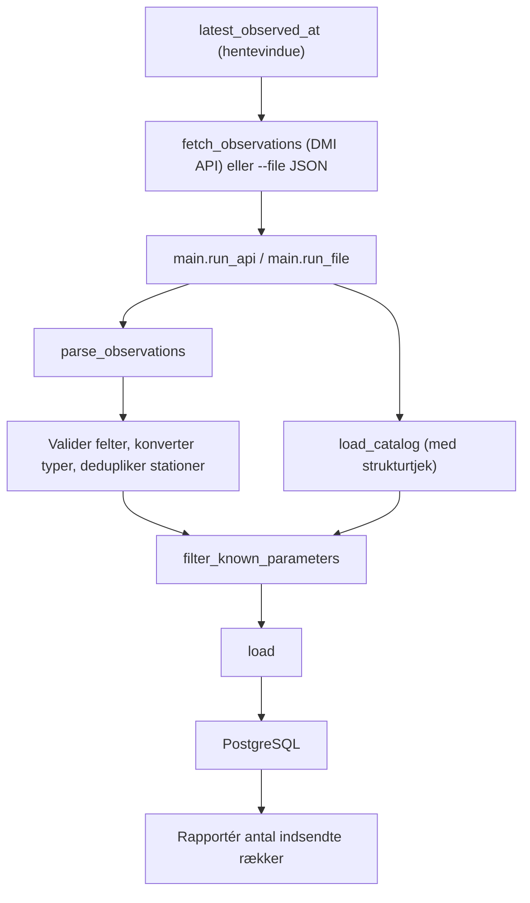
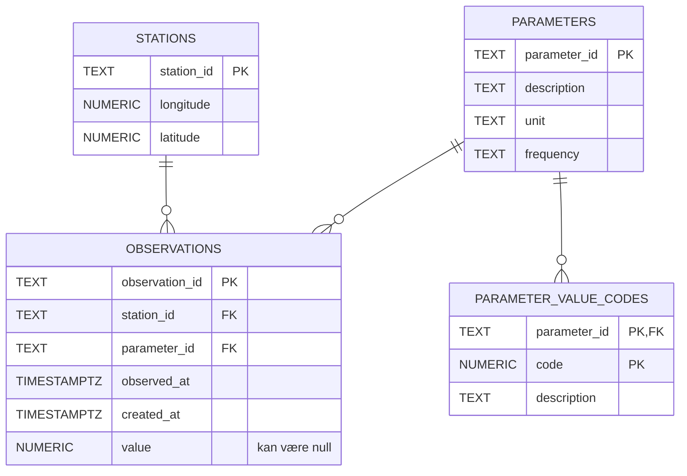

# DMI OHS-datapipeline — Projektpræsentation

## 1. Hvad projektet gør

Denne Python-pipeline henter DMI-observationer for en eller flere stationer fra
DMI's observations-API, validerer stations- og målingsfelterne, konverterer dem
til typede records, deduplikerer stationer efter ID, springer parametre over,
som mangler i et lokalt DMI-katalog, og upserter dataene i PostgreSQL. Der er
tale om strukturel normalisering, ikke konvertering af måleenheder. Hver kørsel
fortsætter fra den nyeste gemte observation for hver station. En gemt JSON-fil
kan indlæses i stedet med `--file`.

## 2. Pipelinens flow



Loaderen skriver parametermetadata, beskrivelser af værdikoder, stationer og
observationer i den rækkefølge, inden for én transaktion. Upserts gør det
sikkert at indlæse de samme data flere gange; en fejl ruller transaktionen
tilbage (fx hvis en stationsrække afvises, fordi dens længdegrad overtræder
databasens constraint). Flyttede stationer, dublerede målinger og oversprungne
parametre rapporteres som advarsler i stedet for at stoppe indlæsningen.

## 3. Databaseskema



- **`stations`** gemmer én række pr. station med dens længde- og breddegrad.
  Databasen tjekker, at koordinaterne ligger inden for gyldige geografiske
  intervaller.
- **`parameters`** gemmer katalogmetadata: beskrivelse, enhed og frekvens.
- **`parameter_value_codes`** gemmer parameterspecifikke betydninger af kodede
  numeriske værdier. Dens sammensatte primærnøgle er `(parameter_id, code)`.
- **`observations`** gemmer hver måling fra API'et. Dens fremmednøgler til
  station og parameter forbinder den med referencetabellerne; `value` kan være
  null.
- Indekser på `(station_id, observed_at)` og `(parameter_id, observed_at)`
  understøtter almindelige opslag i observationerne.

## 4. Gennemgang af funktionerne

### `dmi_ohs/extract_transform.py`

- **`_require(mapping, key, where)`** tjekker, at et inputobjekt indeholder et
  påkrævet felt, og rejser ellers en `ExtractError`, der angiver placeringen.
- **`_parse_timestamp(raw, where)`** kræver en tidsstempelstreng med tidszone
  og accepterer `Z` som UTC.
- **`_parse_value(raw, where)`** accepterer et endeligt tal eller `null`,
  konverterer tal til `Decimal` og afviser booleans og andre typer.
- **`_parse_station(feature, where)`** læser stations-ID og GeoJSON-koordinater,
  validerer deres typer og geografiske intervaller, konverterer koordinaterne
  til `Decimal` og returnerer en `Station`.
- **`parse_observations(payload)`** validerer hver feature og opretter typede
  `Observation`-records, hvor numeriske værdier konverteres til `Decimal`
  (mens `null` bevares) og tidsstempler med tidszone parses. Den deduplikerer
  stationer efter ID; hvis en stations koordinater varierer i inputtet, beholder
  den koordinaterne fra den seneste observation og returnerer en advarsel. Den
  beholder alle observationer og konverterer ikke måleenheder.
- **`load_catalog(path)`** læser den lokale JSON-fil med parameterkataloget og
  tjekker, at dens sektioner og parameterfelter er til stede.
- **`filter_known_parameters(observations, catalog)`** returnerer de
  observationer, hvis parameter findes i kataloget, samt de sorterede ukendte
  ID'er.

### `dmi_ohs/api.py`

- **`fetch_observations(station_id, start, end, session)`** henter
  observations-API'et side for side, indtil en side kommer tilbage ufuldstændig,
  og samler siderne i én FeatureCollection. Fejl rejser `FetchError`.
- **`make_session()`** opretter en HTTP-session, der prøver igen med backoff
  ved rate limits, serverfejl og afbrudte forbindelser.

### `dmi_ohs/load.py`

- **`load(connection, parsed, catalog)`** forbereder katalog-, stations- og
  observationsrækker; upserter de fire tabelgrupper i fremmednøgle-rækkefølge
  inden for én transaktion; og returnerer antallet af indsendte inputrækker pr.
  gruppe. Disse tal er ikke antallet af nyindsatte eller ændrede rækker i
  databasen. Den advarer også, når en gemt station er flyttet, eller når en
  måling er gemt under mere end ét observations-ID.
- **`latest_observed_at(connection, station_id)`** returnerer tidspunktet for
  den nyeste gemte observation for en station.

### `dmi_ohs/main.py`

- **`fetch_window(connection, station_id, lookback, now)`** starter én time før
  den nyeste gemte observation, eller `lookback` før nu, hvis der ikke er
  nogen, og slutter nu.
- **`station_ids_from_env()`** læser den kommaseparerede `DMI_STATION_IDS` og
  fjerner tomme værdier og gentagelser.
- **`lookback_from_env()`** læser `DMI_INITIAL_LOOKBACK_HOURS` og afviser alt,
  der ikke er et positivt tal.
- **`load_payload(connection, payload, catalog)`** parser, filtrerer og indlæser
  én payload og udskriver dens advarsler.
- **`run_api(fetch)`** henter og indlæser hver station i sin egen transaktion.
  En API-, input- eller databasefejl får kun den pågældende station til at
  fejle. Den returnerer hver stations `LoadResult` (eller `None`, når der ikke
  var nye observationer), og rejser `PipelineError` efter løkken, hvis nogen
  station fejlede.
- **`run_file(input_path)`** indlæser en gemt JSON-fil og rejser
  `PipelineError`, hvis filen mangler, eller dens indhold er ugyldigt.
- **`run_every(interval)`** tjekker indstillingerne én gang og kalder derefter
  `run_api()` hvert `interval`, indtil den stoppes. En kørsel, der fejler på
  grund af API'et eller databasen, rapporteres, og løkken venter på næste
  kørsel. Kørslerne holder en fast rytme, og en kørsel, der overskrider
  intervallet, springer de missede tidspunkter over. Compose-servicen
  `collector` bruger den.
- **`main()`** kalder `run_every()`, når `--every MINUTES` er angivet,
  `run_file()`, når `--file` er angivet, og ellers `run_api()` én gang. Den
  afslutter med en fejlmeddelelse i stedet for en traceback, når en station,
  indstilling eller inputfil er forkert.

## 5. Tests og hvordan de køres

Kør projektets test-service med:

```sh
docker compose run --build --rm tests
```

Servicen kører `pytest --cov=dmi_ohs`. PostgreSQL skal være tilgængelig via
Docker Compose. `tests`-servicen forbinder til en separat database på den samme
PostgreSQL-server, navngivet af `TEST_POSTGRES_DB` (standard `dmi_ohs_test`).
Ved første initialisering af et tomt volume opretter `database/init-test-db.sh`
den database og anvender det samme `database/schema.sql` som app-databasen.
Oprydningen efter integrationstests tømmer kun tabeller i testdatabasen.

PostgreSQL's initialiseringsfiler køres ikke igen for et eksisterende
data-volume. At genskabe det med `docker compose down -v` sletter begge
databaser og pgAdmin-indstillingerne, så gør det kun, når de data kan undværes.

### Unit tests — `tests/unit/test_extract_transform.py`

Bruger den gemte Odense-fixture til at tjekke vellykket parsing,
deduplikering af stationer, decimalværdier, tidsstempler med tidszone og
frafiltrering af ukendte parametre. Tests med ugyldigt input verificerer
brugbare fejlmeddelelser ved manglende eller fejlformede felter, ugyldige
tidsstempler og værdier, ikke-endelige tal, ugyldige koordinater eller
koordinater uden for intervallet, ID'er, der ikke er strenge, og fejlformede
kataloger. De tjekker også, at `null`-værdier og intervallernes endepunkter for
koordinater accepteres, og at modstridende stationskoordinater afgøres efter
den seneste observation med en advarsel.

### Unit tests — `tests/unit/test_api.py`

Bruger en falsk HTTP-session (uden netværk) til at tjekke request-parametre,
UTC-tidsformatering, sammenfletning af flere sider, stop ved en ufuldstændig
eller tom side trods et `next`-link, `FetchError` ved fejl samt
retry-konfigurationen.

### Unit tests — `tests/unit/test_main.py`

Tjekker, at `DMI_STATION_IDS` splittes ved kommaer, trimmes, deduplikeres i
rækkefølge, har standardværdien `06120` og afvises, når den ikke indeholder
nogen ID'er. Tjekker, at `DMI_INITIAL_LOOKBACK_HOURS` har standardværdien 24 og
skal være et positivt tal, og at manglende eller ugyldigt `--file`-input giver
en pæn fejlmeddelelse.

Testene af `run_every` bruger et falsk ur, så de aldrig venter i virkeligheden.
De tjekker den faste rytme, overspringning af tidspunkter efter en langsom
kørsel, at fejlede kørsler (stations- eller databasefejl) ikke stopper løkken,
mens andre fejl gør, at ugyldige indstillinger stopper den før første kørsel,
og at `--every` skal være et positivt tal og ikke kan kombineres med `--file`.

### Integrationstests — `tests/integration/`

- **`test_database_connection`** verificerer, at den konfigurerede
  PostgreSQL-forbindelse kan udføre en simpel forespørgsel.
- **`test_load_populates_tables`** tjekker, at en indlæsning skriver de
  forventede observationer, station, parametre og værdikoder.
- **`test_load_is_idempotent`** indlæser det samme input to gange og tjekker,
  at der ikke oprettes dublerede records.
- **`test_failed_load_rolls_back`** fjerner en påkrævet parameter fra
  kataloget, forventer at indlæsningen fejler, og verificerer, at der ikke er
  delvise data tilbage.
- **`test_run_file_loads_sample`** afprøver `run_file()` med eksempelfilen og
  verificerer, at observationerne når databasen.
- **`test_station_move_is_overwritten_with_warning`** og
  **`test_duplicate_measurement_is_kept_with_warning`** tjekker advarslerne ved
  indlæsning.
- **`test_run_api_resumes_after_latest_observation`** kører to gange med en
  falsk fetch og tjekker det indledende lookback, overlappet på én time ved
  anden kørsel, og at overlappet ikke dublerer rækker.
- **`test_run_api_loads_each_station_with_its_own_window`** tjekker, at en
  gemt station fortsætter, mens en ny station bruger lookback.
- **`test_run_api_continues_after_a_failing_station`** og
  **`test_run_api_continues_after_a_database_error`** tjekker, at én fejlende
  station (API- eller databasefejl) ikke stopper de andre, og at den fejlede
  stations rækker rulles tilbage.
- **`test_run_api_with_no_new_observations`** og
  **`test_run_api_skips_unknown_parameters`** dækker tomme API-resultater og
  ukendte parametre.

## 6. Nuværende status og næste skridt

Inkrementel hentning fra DMI's API, parsing, validering af kataloget,
transaktionel indlæsning i databasen, planlagt indsamling med
`collector`-servicen og automatiserede tests med en isoleret testdatabase er på
plads. Næste skridt er et dashboard til datavisualisering, bygget som en
Compose-service, der læser fra databasen.
