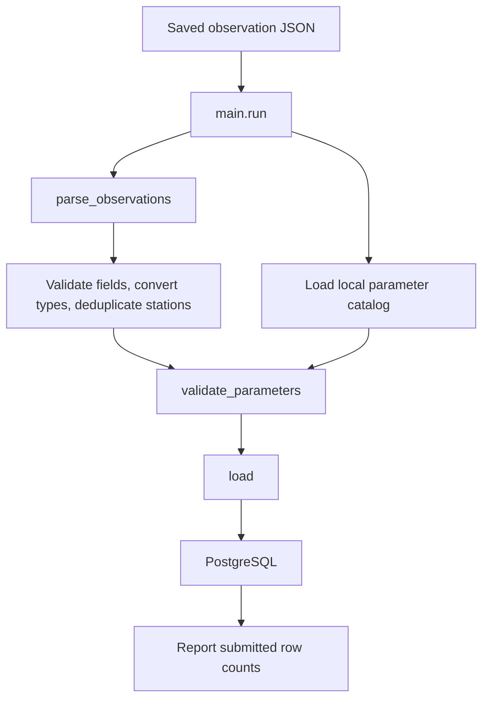
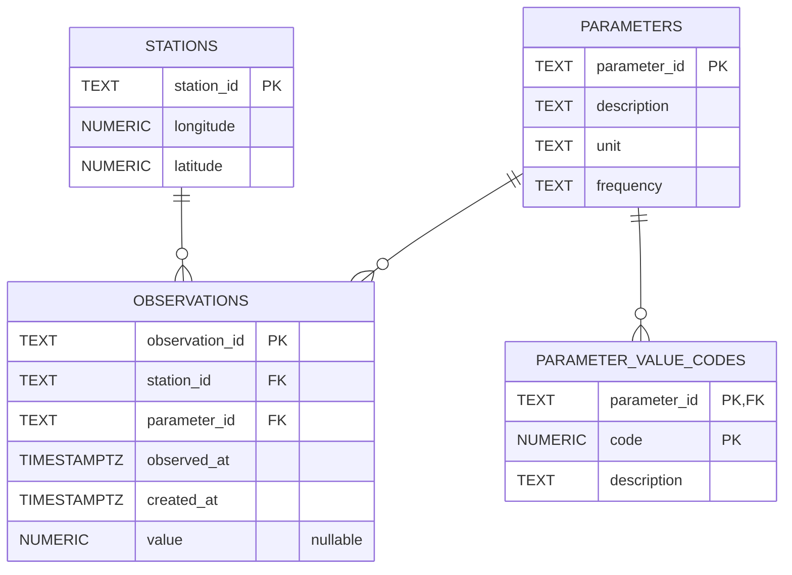

# DMI OHS Data Pipeline — Project Presentation

## 1. What the project does

This Python pipeline takes a saved DMI observation JSON file, validates its
station and measurement fields, converts them into typed records, deduplicates
stations by ID, checks parameter IDs against a local DMI catalog, and upserts
the data into PostgreSQL. This is structural normalization, not measurement
unit conversion. It uses the bundled Odense sample by default; a different
JSON file can be supplied on the command line.

**Current scope:** the pipeline reads saved JSON files. It does not yet fetch
observations directly from the DMI API.

## 2. Pipeline flow



The loader writes parameter metadata, value-code descriptions, stations, and
observations in that order, inside one transaction. Upserts make repeated
loads safe; a failure rolls the transaction back (e.g. if a station row is rejected because its longitude violates the database constraint).

## 3. Database schema



- **`stations`** stores one row per station and its longitude/latitude. The
  database checks that coordinates are within valid geographic ranges.
- **`parameters`** stores catalog metadata: description, unit, and frequency.
- **`parameter_value_codes`** stores parameter-specific meanings for coded
  numeric values. Its composite primary key is `(parameter_id, code)`.
- **`observations`** stores each API measurement. Its station and parameter
  foreign keys connect it to the reference tables; `value` can be null.
- Indexes on `(station_id, observed_at)` and `(parameter_id, observed_at)`
  support common observation lookups.

## 4. Function walkthrough

### `dmi_ohs/extract_transform.py`

- **`_require(mapping, key, where)`** checks that an input object contains a
  required field and raises a location-specific `ExtractError` otherwise.
- **`_parse_timestamp(raw, where)`** requires a timezone-aware timestamp string
  and accepts `Z` as UTC.
- **`_parse_value(raw, where)`** accepts a finite number or `null`, converts
  numbers to `Decimal`, and rejects booleans and other types.
- **`_parse_station(feature, where)`** reads station ID and GeoJSON coordinates,
  validates their types and geographic ranges, converts coordinates to
  `Decimal`, and returns a `Station`.
- **`parse_observations(payload)`** validates each feature and creates
  typed `Observation` records, converting numeric values to `Decimal` (while
  preserving `null`) and parsing timezone-aware timestamps. It deduplicates
  stations by ID, rejects conflicting coordinates for one station, and keeps
  every observation; it does not convert measurement units.
- **`load_catalog(path)`** reads and decodes the local parameter-catalog JSON.
- **`validate_parameters(observations, catalog)`** rejects observations whose
  parameter IDs are not present in the catalog.

### `dmi_ohs/load.py`

- **`load(connection, parsed, catalog)`** prepares catalog, station, and
  observation rows; upserts the four table groups in foreign-key order within
  one transaction; and returns the number of input rows submitted per group.
  Those counts are not counts of newly inserted or changed database rows.

### `dmi_ohs/main.py`

- **`run(input_path)`** reads the selected JSON, parses and validates it, opens
  the database connection, loads the data, closes the connection, prints the
  row counts, and returns the `LoadResult`.
- **`main()`** uses the first command-line argument as the input path when
  provided; otherwise it runs with the bundled Odense sample.

## 5. Tests and how to run them

Run the project test service with:

```sh
docker compose run --build --rm tests
```

The service runs `pytest --cov=dmi_ohs`. PostgreSQL must be available through
Docker Compose. The `tests` service connects to a separate database on the same
PostgreSQL server, named by `TEST_POSTGRES_DB` (default `dmi_ohs_test`). On the
first initialization of an empty volume, `database/init-test-db.sh` creates
that database and applies the same `database/schema.sql` as the app database.
Integration-test cleanup truncates only tables in the test database.

PostgreSQL initialization files do not run again for an existing data volume.
Recreating it with `docker compose down -v` deletes both databases and pgAdmin
settings, so only do this while that data can be discarded.

### Unit tests — `tests/unit/test_extract_transform.py`

Use the saved Odense fixture to check successful parsing, station
deduplication, decimal values, timezone-aware timestamps, and parameter IDs
present in the catalog. Invalid-input cases verify helpful errors for missing
or malformed fields, invalid timestamps and values, non-finite numbers,
invalid/out-of-range coordinates, non-string IDs, and conflicting station
coordinates. They also check that `null` values and coordinate range endpoints
are accepted.

### Integration tests — `tests/integration/`

- **`test_database_connection`** verifies the configured PostgreSQL connection
  can execute a simple query.
- **`test_load_populates_tables`** checks that a load writes the expected
  observations, station, parameters, and value codes.
- **`test_load_is_idempotent`** loads the same input twice and checks that
  duplicate records are not created.
- **`test_failed_load_rolls_back`** removes a required parameter from the
  catalog, expects the load to fail, and verifies that no partial data remains.
- **`test_main_run_loads_sample`** exercises the `run()` entry point against
  the sample file and verifies that observations reach the database.

## 6. Current status and next step

The parsing, catalog validation, transactional database loading, and automated
tests with an isolated test database are in place. A natural next step is to
start fetching observations directly from the DMI API, then consider API
timeout/retry handling and broader pipeline
coverage. Afterwards, if project scope and time contraints allow it, a real-time data visualisations dashboard could be implemented.
