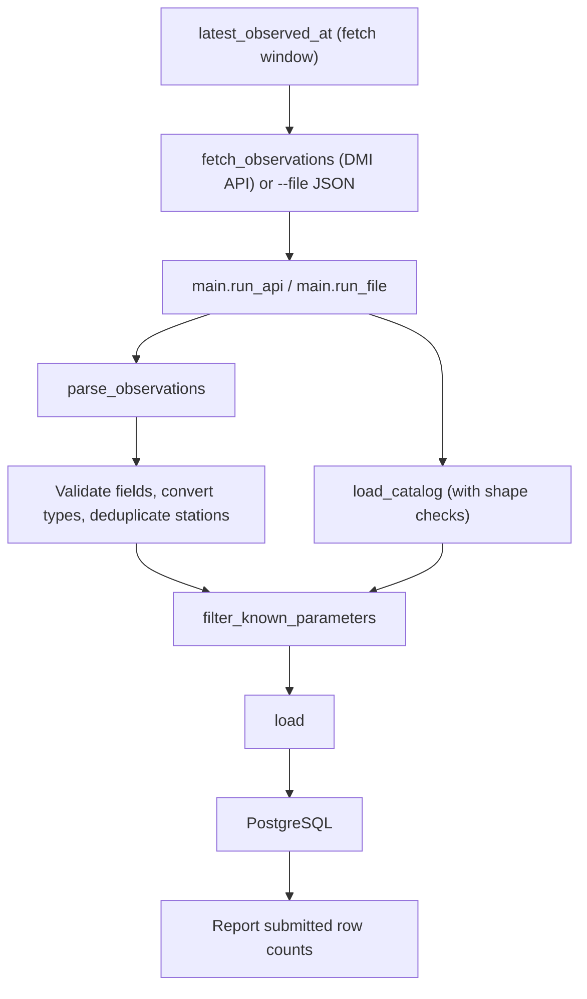
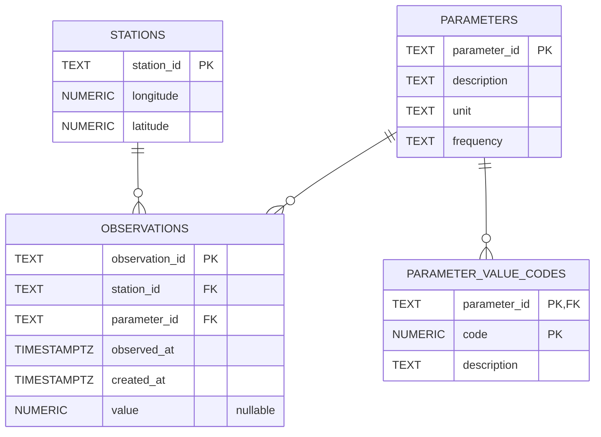

# DMI OHS Data Pipeline — Project Presentation

## 1. What the project does

This Python pipeline fetches DMI observations for one or more stations from
the DMI observation API, validates the station and measurement fields, converts them
into typed records, deduplicates stations by ID, skips parameters missing from
a local DMI catalog, and upserts the data into PostgreSQL. This is structural
normalization, not measurement unit conversion. Each run continues from each
station's newest stored observation. A saved JSON file can be loaded instead with
`--file`.

## 2. Pipeline flow



The loader writes parameter metadata, value-code descriptions, stations, and
observations in that order, inside one transaction. Upserts make repeated
loads safe; a failure rolls the transaction back (e.g. if a station row is rejected because its longitude violates the database constraint).
Moved stations, duplicate measurements, and skipped parameters are reported
as warnings instead of stopping the load.

## 3. Database schema



- **`stations`** stores one row per station and its longitude/latitude. The
  database checks that coordinates are within valid geographic ranges.
- **`parameters`** stores catalog metadata: description, unit, and frequency.
- **`parameter_value_codes`** stores parameter-specific meanings for coded
  numeric values. Its composite primary key is `(parameter_id, code)`.
- **`observations`** stores each API measurement. Its station and parameter
  foreign keys connect it to the reference tables; `value` can be null.
- Indexes on `(station_id, observed_at)` and `(parameter_id, observed_at)`
  support common observation lookups.

## 4. Function walkthrough

### `dmi_ohs/extract_transform.py`

- **`_require(mapping, key, where)`** checks that an input object contains a
  required field and raises a location-specific `ExtractError` otherwise.
- **`_parse_timestamp(raw, where)`** requires a timezone-aware timestamp string
  and accepts `Z` as UTC.
- **`_parse_value(raw, where)`** accepts a finite number or `null`, converts
  numbers to `Decimal`, and rejects booleans and other types.
- **`_parse_station(feature, where)`** reads station ID and GeoJSON coordinates,
  validates their types and geographic ranges, converts coordinates to
  `Decimal`, and returns a `Station`.
- **`parse_observations(payload)`** validates each feature and creates
  typed `Observation` records, converting numeric values to `Decimal` (while
  preserving `null`) and parsing timezone-aware timestamps. It deduplicates
  stations by ID; if one station's coordinates differ within the input, it
  keeps those of the latest observation and returns a warning. It keeps every
  observation and does not convert measurement units.
- **`load_catalog(path)`** reads the local parameter-catalog JSON and checks
  that its sections and parameter fields are present.
- **`filter_known_parameters(observations, catalog)`** returns the
  observations whose parameter is in the catalog, plus the sorted unknown IDs.

### `dmi_ohs/api.py`

- **`fetch_observations(station_id, start, end, session)`** requests the
  observation API page by page until a page comes back short, and merges the
  pages into one FeatureCollection. Failures raise `FetchError`.
- **`make_session()`** creates an HTTP session that retries rate limits,
  server errors, and dropped connections with backoff.

### `dmi_ohs/load.py`

- **`load(connection, parsed, catalog)`** prepares catalog, station, and
  observation rows; upserts the four table groups in foreign-key order within
  one transaction; and returns the number of input rows submitted per group.
  Those counts are not counts of newly inserted or changed database rows. It
  also warns when a stored station has moved or a measurement is stored under
  more than one observation ID.
- **`latest_observed_at(connection, station_id)`** returns the newest stored
  observation time for a station.

### `dmi_ohs/main.py`

- **`fetch_window(connection, station_id, lookback, now)`** starts one hour
  before the newest stored observation, or `lookback` before now if there is
  none, and ends now.
- **`station_ids_from_env()`** reads the comma-separated `DMI_STATION_IDS`,
  dropping blanks and repeats.
- **`lookback_from_env()`** reads `DMI_INITIAL_LOOKBACK_HOURS` and rejects
  anything that is not a positive number.
- **`load_payload(connection, payload, catalog)`** parses, filters, and loads
  one payload, and prints its warnings.
- **`run_api(fetch)`** fetches and loads each station in its own transaction.
  An API, input or database error fails only that station. It returns each
  station's `LoadResult` (or `None` when there were no new observations), and
  raises `PipelineError` after the loop if any station failed.
- **`run_file(input_path)`** loads a saved JSON file, and raises
  `PipelineError` if the file is missing or its content is invalid.
- **`main()`** calls `run_file()` when `--file` is given, otherwise `run_api()`,
  and exits with an error message instead of a traceback when a station,
  setting or input file is wrong.

## 5. Tests and how to run them

Run the project test service with:

```sh
docker compose run --build --rm tests
```

The service runs `pytest --cov=dmi_ohs`. PostgreSQL must be available through
Docker Compose. The `tests` service connects to a separate database on the same
PostgreSQL server, named by `TEST_POSTGRES_DB` (default `dmi_ohs_test`). On the
first initialization of an empty volume, `database/init-test-db.sh` creates
that database and applies the same `database/schema.sql` as the app database.
Integration-test cleanup truncates only tables in the test database.

PostgreSQL initialization files do not run again for an existing data volume.
Recreating it with `docker compose down -v` deletes both databases and pgAdmin
settings, so only do this while that data can be discarded.

### Unit tests — `tests/unit/test_extract_transform.py`

Use the saved Odense fixture to check successful parsing, station
deduplication, decimal values, timezone-aware timestamps, and filtering of
unknown parameters. Invalid-input cases verify helpful errors for missing
or malformed fields, invalid timestamps and values, non-finite numbers,
invalid/out-of-range coordinates, non-string IDs, and malformed catalogs.
They also check that `null` values and coordinate range endpoints are
accepted, and that conflicting station coordinates resolve to the latest
observation with a warning.

### Unit tests — `tests/unit/test_api.py`

Use a fake HTTP session (no network) to check request parameters, UTC time
formatting, merging of multiple pages, stopping on a short or empty page
despite a `next` link, `FetchError` on failures, and the retry configuration.

### Unit tests — `tests/unit/test_main.py`

Check that `DMI_STATION_IDS` is split on commas, trimmed, deduplicated in
order, defaults to `06120`, and is rejected when it contains no IDs. Check that
`DMI_INITIAL_LOOKBACK_HOURS` defaults to 24 and must be a positive number, and
that a missing or invalid `--file` input gives a clean error message.

### Integration tests — `tests/integration/`

- **`test_database_connection`** verifies the configured PostgreSQL connection
  can execute a simple query.
- **`test_load_populates_tables`** checks that a load writes the expected
  observations, station, parameters, and value codes.
- **`test_load_is_idempotent`** loads the same input twice and checks that
  duplicate records are not created.
- **`test_failed_load_rolls_back`** removes a required parameter from the
  catalog, expects the load to fail, and verifies that no partial data remains.
- **`test_run_file_loads_sample`** exercises `run_file()` with the sample
  file and verifies that observations reach the database.
- **`test_station_move_is_overwritten_with_warning`** and
  **`test_duplicate_measurement_is_kept_with_warning`** check the load warnings.
- **`test_run_api_resumes_after_latest_observation`** runs twice with a
  fake fetch and checks the initial lookback, the one-hour overlap on the
  second run, and that the overlap does not duplicate rows.
- **`test_run_api_loads_each_station_with_its_own_window`** checks that a
  stored station continues while a new station uses the lookback.
- **`test_run_api_continues_after_a_failing_station`** and
  **`test_run_api_continues_after_a_database_error`** check that one failing
  station (API or database error) doesn't stop the others, and that the failed
  station's rows are rolled back.
- **`test_run_api_with_no_new_observations`** and
  **`test_run_api_skips_unknown_parameters`** cover empty API results and
  unknown parameters.

## 6. Current status and next step

Incremental fetching from the DMI API, parsing, catalog validation,
transactional database loading, and automated tests with an isolated test
database are in place. A natural next step is to schedule regular runs and
add continuous integration. Afterwards, if project scope and time contraints allow it, a real-time data visualisations dashboard could be implemented.
